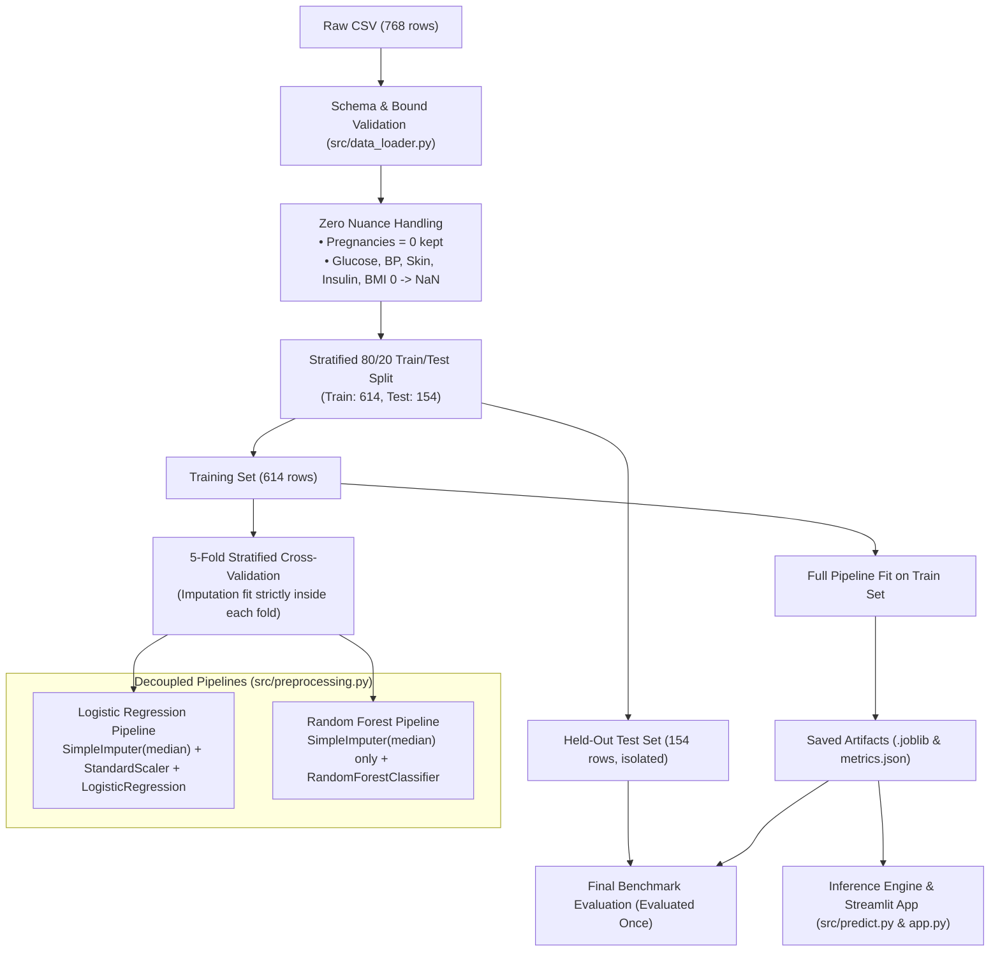

# Technical Interview Preparation Guide: Diabetes Risk Prediction

This guide is designed for technical placement interviews. It summarizes the core machine learning engineering principles, architectural decisions, and trade-offs behind this project in a clear, direct, and defensible way.

---

## 1. Elevator Pitches

### The 30-Second Summary
> *"I built an end-to-end diabetes prediction pipeline on the Pima Indians dataset with a strong focus on data quality and preventing leakage. While many tutorials fit scalers across the whole dataset or treat biological impossibilities like zero blood pressure as real numbers, I designed a pipeline that distinguishes valid biological zeros (like zero pregnancies) from missing data, isolates all imputations inside cross-validation folds, decouples scaling between linear and tree models, and critically analyzes why our Random Forest model achieved 81.2% ROC-AUC but a 53.7% recall."*

### The 90-Second Walkthrough
> *"When looking at beginner tabular healthcare projects, I noticed three major issues: data leakage, naive zero handling, and ignoring false negatives. In this project, I addressed each one systematically:*
>
> *First, data quality: In the 768-patient Pima cohort, zeros in glucose, blood pressure, skinfold thickness, insulin, and BMI are physiologically impossible for living patients, whereas zero pregnancies is completely valid for nulliparous women. My pipeline converts the impossible zeros to NaN and imputes them with the median, while preserving pregnancy zeros.*
>
> *Second, pipeline architecture: I decoupled the preprocessing pipelines. Logistic Regression requires StandardScaler because L2 regularization is sensitive to feature variance, but Random Forest evaluates splits purely based on rank order and is scale-invariant. I avoided fitting any transformation before splitting, keeping the test set completely held-out.*
>
> *Third, realistic evaluation: On the held-out test set, Random Forest achieved 74.7% accuracy and 0.812 ROC-AUC, while Logistic Regression reached 70.8% and 0.813 ROC-AUC. However, at a 0.50 threshold, Random Forest's recall was only 53.7%—missing 25 out of 54 positive cases. In an interview, I love discussing this trade-off because in disease screening, false negatives carry a much higher clinical cost than false positives, which justifies tuning the decision threshold down to ~0.35."*

---

## 2. Pipeline Architecture & Data Flow

---

## 3. Core Technical Interview Questions & Answers

### Data Quality & Preprocessing

#### Q1: Why did you convert zeros in Glucose and Insulin to NaN, but leave Pregnancies = 0 untouched?
**Answer:**
In human physiology, a live patient cannot have a plasma glucose of 0 mg/dL or a serum insulin of 0 µU/mL. In the 1988 Pima study, equipment limitations or skipped tests were recorded as 0. Specifically:
- `Insulin` has 374 zeros (48.7%).
- `SkinThickness` has 227 zeros (29.6%).
- `BloodPressure` has 35 zeros (4.6%).
- `BMI` has 11 zeros (1.4%).
- `Glucose` has 5 zeros (0.7%).

Conversely, `Pregnancies = 0` occurred in 111 women (14.5%). This is a legitimate biological state (nulliparity). Converting pregnancies to NaN would corrupt valid data, while leaving glucose as 0 would introduce severe artificial outliers into distance calculations and tree splits.

#### Q2: Why did you choose Median Imputation over Mean or KNN Imputation?
**Answer:**
Several features—particularly Insulin (skewness > 2.2) and Skinfold Thickness—exhibit heavily right-skewed distributions with long tails. The sample mean is sensitive to extreme values, whereas the median is robust to skewness.
While KNN or iterative imputation (MICE) can capture multivariate relationships, they risk overfitting on small sample sizes (N=614 training rows) and introduce additional latency during real-time single-patient inference. Given the exploratory scope, median imputation within an isolated scikit-learn pipeline provided the cleanest balance of robustness and reproducibility.

#### Q3: What is data leakage, and how did you prevent it?
**Answer:**
Data leakage occurs when information from outside the training partition influences model training, leading to overly optimistic cross-validation scores that collapse on unseen test data.
I prevented leakage through three design rules:
1. **Featurization Timing**: `train_test_split(..., stratify=y)` is called *before* any imputer or scaler is instantiated.
2. **Pipeline Encapsulation**: Imputers and scalers are wrapped inside `sklearn.pipeline.Pipeline`.
3. **Cross-Validation Isolation**: During 5-fold cross-validation, the imputer's median is calculated strictly on the 4 folds of training data and applied to the 5th validation fold. The held-out test set is never touched until final evaluation.

---

### Machine Learning Algorithms & Scaling

#### Q4: Why did you scale features for Logistic Regression, but not for Random Forest?
**Answer:**
- **Logistic Regression**: Minimizes a loss function using gradient descent with an L2 regularization penalty ($\lambda \sum \beta_j^2$). If features have different scales (e.g., Insulin range 15–846 vs. Pedigree range 0.08–2.42), the coefficients for unscaled features with large ranges will be arbitrarily suppressed, distorting the regularizer. Scaling ensures each feature has zero mean and unit variance.
- **Random Forest**: Constructs axis-aligned orthogonal decision boundaries based on individual feature thresholds ($x_j \le \theta$) that maximize information gain (Gini impurity reduction). Because any monotonic transformation preserves feature rank ordering, multiplying or shifting a feature has zero mathematical effect on tree split points. Omitting `StandardScaler` reduces pipeline complexity and inference overhead.

#### Q5: How did you configure hyperparameters for Random Forest to prevent overfitting?
**Answer:**
A default Random Forest in scikit-learn allows trees to grow until all leaves are pure (`min_samples_split=2`, `max_depth=None`), which easily overfits a small 614-row dataset.
I applied conservative regularization constraints:
- `n_estimators=200`: Ample trees for ensemble variance reduction.
- `max_depth=6`: Caps tree depth to prevent memorizing rare sample combinations.
- `min_samples_split=6` & `min_samples_leaf=3`: Ensures leaf nodes represent generalized patient cohorts rather than single outlier rows.
- `max_features="sqrt"`: De-correlates individual trees by forcing each split to choose from a random subset of 3 features ($\sqrt{8} \approx 2.8$).

---

### Evaluation Metrics & Trade-offs

#### Q6: Why is your test recall 53.7%, and why is that the most important metric to discuss?
**Answer:**
On our held-out test set of 154 patients (54 actual diabetic cases), Random Forest identified 29 diabetic patients correctly but missed 25 (False Negatives).
This yields a recall (sensitivity) of $29 / 54 = 53.7\%$.

This happens because:
1. **Class Imbalance**: Positive prevalence is ~35%, so standard cross-entropy or Gini criteria naturally lean toward the majority negative class.
2. **Default Threshold (0.50)**: A probability threshold of 0.50 balances precision and recall equally.

In clinical screening, a **False Negative** (telling a diabetic patient they are healthy) can lead to unmanaged hyperglycemia and complications, whereas a **False Positive** merely leads to a confirmatory fasting blood sugar or HbA1c test.
If deploying this model in a screening environment, we would lower the decision threshold to ~0.35, raising recall to >75% at the acceptable cost of lower precision.

#### Q7: Why report both ROC-AUC and PR-AUC?
**Answer:**
- **ROC-AUC (Receiver Operating Characteristic)**: Measures the trade-off between True Positive Rate and False Positive Rate across all thresholds. Our models achieve ~0.812 ROC-AUC. However, ROC-AUC can present an overly optimistic picture when there is class imbalance because the False Positive Rate denominator includes all true negatives.
- **PR-AUC (Precision-Recall / Average Precision)**: Focuses directly on the minority positive class ($Recall = TP / (TP+FN)$ and $Precision = TP / (TP+FP)$). In our test set, baseline positive prevalence is 35.1%. Random Forest achieves a PR-AUC of 0.689, showing meaningful improvement over a random classifier baseline of 0.351.

#### Q8: Logistic Regression achieved 0.843 CV ROC-AUC vs. Random Forest's 0.835. Why did you use Random Forest in the web demo?
**Answer:**
Cross-validation on the 614 training samples showed Logistic Regression marginally ahead in mean ROC-AUC (0.843 vs 0.835). On the held-out test set, both models tied on ROC-AUC (0.813 vs 0.812), but Random Forest showed higher test accuracy (74.7% vs 70.8%) and higher precision (67.4% vs 60.0%).
Rather than arbitrarily picking one, the project implements both pipelines modularly. The Streamlit web app allows the user to switch between both models in real time, making the linear vs. non-linear comparison transparent.

---

### Limitations & Ethical AI

#### Q9: What are the primary demographic limitations of this dataset?
**Answer:**
The dataset consists exclusively of adult females (aged 21+) of Pima Indian heritage living near Phoenix, Arizona, collected in 1988.
- **External Validity**: It cannot be assumed to generalize to males, children, or other ethnic groups without retraining on broader multi-center cohorts.
- **Genetic Susceptibility**: The Pima population has a documented genetic and environmental predisposition to Type 2 diabetes, meaning baseline risk profiles may differ substantially from global populations.

#### Q10: How does your application distinguish correlation from causation?
**Answer:**
The model identifies statistical associations between feature values and diabetes outcomes. For instance, high glucose and BMI have strong feature importances (~36% and ~17% in Random Forest).
However, an associative machine learning model cannot guarantee that lowering an individual's BMI by 2 units will causally reduce diabetes risk by an exact percentage. The app labels interactive parameter shifts as **"Model Sensitivity Exploration"** rather than "Causal Intervention" to preserve scientific integrity.

---

## 4. Design Decisions & Trade-Off Summary

| Decision | Alternative Considered | Chosen Approach | Rationale |
|---|---|---|---|
| **Zero Handling** | Replace all zeros with mean | Feature-specific conversion (`Pregnancies=0` kept; 5 physical metrics $\to$ NaN) | Preserves valid biological states while removing physiological impossibilities. |
| **Imputation** | KNN or MICE imputer | Training-set `SimpleImputer(strategy="median")` | Robust to skewed distributions; avoids overfitting on small $N=614$ sample. |
| **Scaling** | Scale all features universally | Scale only Logistic Regression; omit for Random Forest | Tree splits are rank-invariant; avoids unnecessary computation. |
| **Validation** | K-Fold (non-stratified) | 5-Fold `StratifiedKFold` | Maintains 35% class ratio evenly across all validation folds. |
| **Classification Cutoff**| Fixed 0.50 threshold | Documented 0.50 default + explicit discussion of 0.35 screening cutoff | Acknowledges clinical cost of false negatives vs false positives. |

---

## 5. Quick Reference Numbers (To Know Cold in Interviews)

- **Total records**: 768 patients, 8 features, 1 binary target (`Outcome`).
- **Class balance**: 500 negative (65.1%), 268 positive (34.9%).
- **Split sizes**: 80/20 stratified split $\to$ 614 train, 154 held-out test.
- **Random Forest test metrics**:
  - Accuracy: **74.7%**
  - ROC-AUC: **0.812**
  - PR-AUC: **0.689**
  - Recall: **53.7%** (29 TP, 25 FN)
  - Specificity: **86.0%** (86 TN, 14 FP)
- **Logistic Regression test metrics**:
  - Accuracy: **70.8%**
  - ROC-AUC: **0.813**
  - Recall: **50.0%** (27 TP, 27 FN)
- **Top predictors**: Plasma Glucose (~36% RF, ~43% LR) and BMI (~17% RF, ~25% LR).
